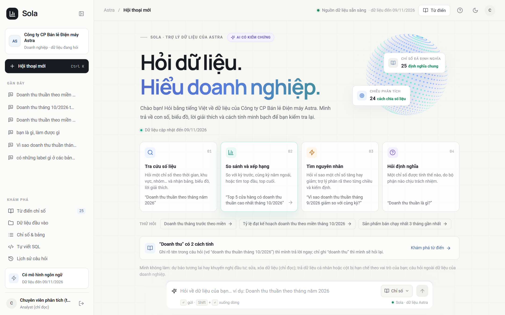

# Sola · Trợ lý phân tích dữ liệu AI

Hỏi dữ liệu doanh nghiệp bằng **tiếng Việt**, nhận **bảng, biểu đồ và lời giải thích có đối chiếu số liệu**.
Sola chuyển câu hỏi thành SQL, kiểm tra quyền truy cập và cho phép xem lại cách tính ngay trong câu trả lời.



## Điểm nổi bật

- Tra cứu, so sánh, xếp hạng và phân tích nguyên nhân biến động; nhớ ngữ cảnh khi hỏi tiếp.
- Thống nhất cách tính qua semantic layer; hỏi lại khi câu hỏi có nhiều cách hiểu.
- Kiểm tra SQL chỉ đọc, RBAC/RLS, cột nhạy cảm và chi phí; yêu cầu duyệt khi truy vấn lớn.
- Giao diện sáng/tối, hỗ trợ điện thoại, từ điển chỉ số, xem SQL và tải CSV.
- Hai workspace mẫu: **Astra** (bán lẻ điện máy) và **Apex** (giao vận), dùng dữ liệu giả lập.

## Chạy nhanh

Yêu cầu **Python ≥ 3.11**.

```powershell
git clone https://github.com/buiquyanh9-ai/Self-service-analytics-agent.git
cd Self-service-analytics-agent
pip install -r requirements.txt
```

Chép `.env.example` thành `.env`, điền `OPENROUTER_API_KEY`, rồi chạy:

```powershell
.\run.ps1          # Windows; lần đầu tự sinh dữ liệu mẫu
# Linux/macOS/Git Bash: ./run.sh
```

Mở <http://127.0.0.1:8000>. Tài khoản demo:

| Tài khoản | Mật khẩu | Phạm vi |
|---|---|---|
| `admin` | `admin123` | Quản trị và toàn bộ dữ liệu |
| `analyst` | `analyst123` | Phân tích toàn quốc, chặn cột nhạy cảm |
| `analyst_bac` / `analyst_nam` | `analyst123` | Chỉ dữ liệu Miền Bắc / Miền Nam |

Thử hỏi: *“Doanh thu thuần theo miền tháng 10/2026”* hoặc *“Vì sao doanh thu thuần tháng 9/2026 giảm so với cùng kỳ?”*.
Không có khóa API, chỉ các câu được bộ luật hiểu trọn vẹn mới được trả lời.

Chạy workspace Apex ở cổng khác:

```powershell
.\run.ps1 -Workspace giaovan_apex -Port 8001
# Linux/macOS/Git Bash: WORKSPACE=giaovan_apex PORT=8001 ./run.sh
```

## Công nghệ và kiểm thử

**FastAPI · DuckDB · HTML/CSS/JavaScript · Chart.js · OpenRouter/Claude**. Frontend không cần bước build.

```powershell
python -m pytest -q tests  # mô hình giả, không gọi API
python -m app.bench check # kiểm tra bộ câu hỏi benchmark
```

## Tài liệu

- [Hướng dẫn sử dụng](docs/02-huong-dan-su-dung.md) — giao diện, đọc kết quả và demo 10 phút.
- [Cài đặt và cấu hình](docs/03-chay-local.md) — chạy local, workspace và nhận kho mới.
- [Kiến trúc và phương pháp](docs/01-ky-thuat-va-phuong-phap.md) — agent, semantic layer và kiểm soát SQL.
- [Triển khai](docs/04-deploy-len-web.md) — Docker, hosting và cấu hình môi trường.
- [Tham chiếu chi tiết](docs/05-tham-chieu.md) — ảnh demo, API, kết quả đánh giá và giới hạn.
- [Benchmark](eval/benchmark/README.md) — ghi nhãn câu hỏi và so sánh cấu hình.

Tài liệu API khi chạy server: <http://127.0.0.1:8000/docs>.
