# Sola · Tham chiếu chi tiết

[← README dự án](../README.md) · [Mục lục tài liệu](README.md)

Agent nhận câu hỏi **tiếng Việt**, tự lập kế hoạch truy vấn, sinh SQL đúng **semantic layer**, kiểm duyệt bằng code
(cú pháp → chỉ đọc → RBAC/RLS → cột PII → dry-run → lint AST → ước lượng bytes quét), **hỏi lại khi mơ hồ**, cho người
dùng **duyệt SQL trước khi chạy trên bảng lớn (HITL)**, chạy trên kho DuckDB, trả về **bảng + biểu đồ + diễn giải có
kiểm chứng số liệu 100%**, tự sửa SQL lỗi, phân tích **nguyên nhân biến động**, và **phát hiện – xử lý sai lệch dữ liệu**
bằng kiểm định thống kê.

Agent gồm nhiều tác tử: **Router** (mô hình nhanh) phân loại ý định, viết lại câu nối tiếp thành câu độc lập và tách
câu nhiều ý; **Planner** (LLM function calling) lập kế hoạch truy vấn; **Repairer** sửa SQL lỗi; **Narrator** viết lời
diễn giải; **Critic** kiểm tra câu trả lời có trúng câu hỏi không (đối chiếu kế hoạch bằng code, rồi mô hình nhanh chấm
kết quả và yêu cầu Planner làm lại khi chưa đúng). Câu hỏi mà bộ hiểu tiếng Việt viết bằng code hiểu **trọn vẹn** đi **đường nhanh**, không gọi mô hình. Cần
`OPENROUTER_API_KEY`; mọi đầu ra của LLM vẫn qua các chốt chặn bằng code. Không còn chế độ offline: câu bộ luật chỉ
hiểu một phần luôn đi qua LLM, LLM lỗi thì báo lỗi thay vì đoán.

Hệ thống **không gắn với một doanh nghiệp**: mỗi doanh nghiệp là một *workspace* gồm bộ cấu hình, dữ liệu và bộ câu
hỏi đánh giá riêng. Repo kèm hai doanh nghiệp mẫu thuộc hai ngành khác nhau (bán lẻ điện máy, chuyển phát) và một công
cụ nhận kho dữ liệu mới (mục 2).

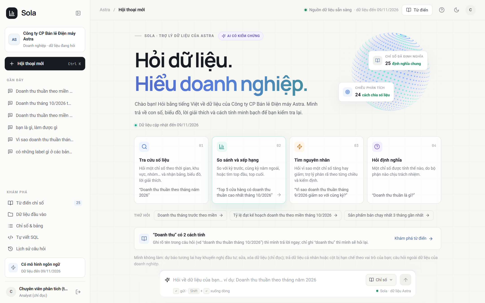

Giao diện **Sola** mở đầu bằng “Hỏi dữ liệu. Hiểu doanh nghiệp.”, quả cầu dữ liệu tương tác và bốn thẻ câu hỏi:
tra cứu số liệu, so sánh và xếp hạng, tìm nguyên nhân, hỏi định nghĩa. Nội dung mẫu thay đổi theo doanh nghiệp.
Thanh bên có **Hội thoại mới**, **Gần đây** và **Khám phá** (từ điển chỉ số, dữ liệu đầu vào, chỉ số & bảng,
tự viết SQL, lịch sử câu hỏi; admin thấy thêm chất lượng dữ liệu, nguồn gốc dữ liệu, đo độ chính xác, cài đặt).

Mỗi câu trả lời hiển thị “Mình hiểu là” bằng các nhãn chỉ số, chiều, thời gian và bộ lọc; kết quả chuyển giữa tab
**Biểu đồ** / **Bảng dữ liệu**, có nút tải CSV. Bên dưới có **Cách tính** (hộp thoại định nghĩa, kiểm tra, SQL và
chi tiết kỹ thuật), **Xem SQL**, **Sao chép**, trạng thái **Đã đối chiếu … số liệu** và nút đánh giá kết quả.
**Từ điển** ở thanh trên hoặc **Từ điển chỉ số** trong **Khám phá** mở ngăn bên tra định nghĩa.
Ô hỏi ở dưới có nút **Chỉ số**; **Enter** gửi, **Shift + Enter** xuống dòng. Có chế độ sáng/tối và menu cho điện thoại.

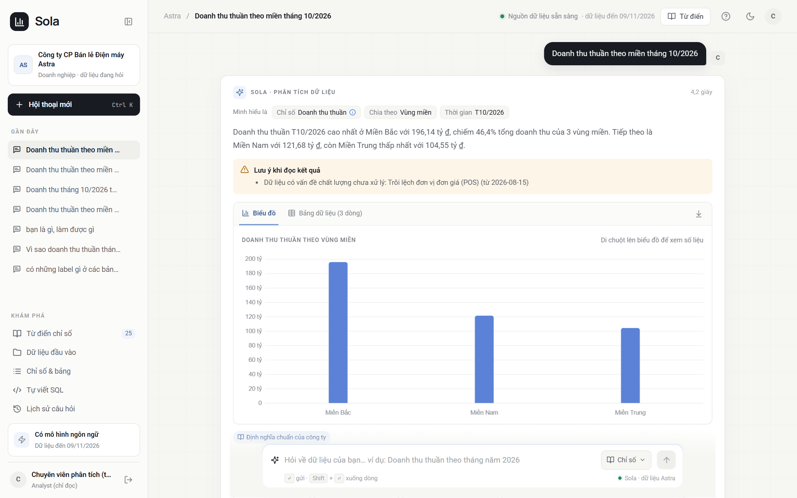

---

## 1. Chạy nhanh

Yêu cầu: Python ≥ 3.11.

```powershell
git clone https://github.com/buiquyanh9-ai/Self-service-analytics-agent.git
cd Self-service-analytics-agent
pip install -r requirements.txt
.\run.ps1                 # lần đầu tự sinh dữ liệu giả (~1 phút) rồi mở server
# hoặc: ./run.sh  (Linux/macOS/Git Bash)
```

Mở <http://127.0.0.1:8000> và đăng nhập bằng nút tài khoản demo:

| Tài khoản | Mật khẩu | Vai trò | Ghi chú |
|---|---|---|---|
| `admin` | `admin123` | Admin | Quản trị schema/catalog, chất lượng dữ liệu, lineage, eval, cài đặt; xem mọi log |
| `analyst` | `analyst123` | Analyst | Chỉ đọc tầng `dw`, bị chặn cột PII/lương |
| `analyst_bac` | `analyst123` | Analyst | + **RLS**: chỉ thấy dữ liệu Miền Bắc |
| `analyst_nam` | `analyst123` | Analyst | + **RLS**: chỉ thấy dữ liệu Miền Nam |

Khóa mô hình: chép `.env.example` thành `.env` ở gốc dự án rồi điền `OPENROUTER_API_KEY` (file `.env` được nạp tự
động và đã nằm trong `.gitignore`):

- Planner mặc định `openai/gpt-6-luna` (đổi bằng `OPENROUTER_MODEL` hoặc trang Cài đặt).
- Router và lời diễn giải mặc định `anthropic/claude-haiku-5.5` (đổi bằng `ROUTER_MODEL`): ở lượt đo 15/11/2026 trên
  10 câu phân loại, model này đúng 10/10 với trung vị 1,65 giây/lượt, so với 4,2 giây của `gpt-6-luna`, cùng giá.
- `ANTHROPIC_API_KEY=sk-ant-...` → gọi Claude trực tiếp (dự phòng; chưa đo).
- Ngân sách thời gian mỗi câu mặc định 10 giây (`latency_budget_s`): câu đã gần hết ngân sách thì bỏ lượt mô hình viết
  lời và dùng bản diễn giải tự động, cũng đã kiểm chứng số liệu.

Không có khóa: chỉ trả lời được câu hỏi nêu rõ chỉ số và thời gian (đường nhanh); câu khác được báo là cần mô hình.

Xem dữ liệu ngoài bot: `python warehouse/view.py` mở cả kho trên trình duyệt bằng DuckDB UI (<http://localhost:4213>,
chỉ đọc, chạy song song với bot được). Cần file rời thì `python warehouse/export.py` xuất mỗi bảng thành một file CSV trong `var/export/<schema>/`, kèm
mục lục `var/export/DANH_SACH_BANG.md` mô tả bảng và cột (thêm `--rows 1000` để chỉ lấy 1000 dòng đầu mỗi bảng,
`--workspace giaovan_apex` cho doanh nghiệp Apex). Đây là bản sao chỉ để xem; bot vẫn đọc `var/warehouse.duckdb`.

Kiểm thử: `python -m pytest -q tests` (316 test: governance, chi phí, semantic, NLU, audit số liệu, so khớp eval, eval hội thoại, giả thuyết biến động, Router
và đường nhanh, vòng lặp gọi tool của LLM, các chốt chặn quanh LLM, đa doanh nghiệp, công cụ nhận kho mới, phần phục vụ
giao diện thân thiện). Không test nào gọi mạng: mọi mô hình được thay bằng client giả trong `tests/fake_llm.py`.

---

## 2. Nhiều doanh nghiệp (workspace)

Mỗi tiến trình phục vụ một doanh nghiệp, chọn bằng biến môi trường `WORKSPACE`; dữ liệu, bộ nhớ hội thoại và log của hai
doanh nghiệp nằm ở hai thư mục khác nhau nên không lẫn vào nhau.

```powershell
.\run.ps1                                   # doanh nghiệp mẫu 1: Công ty CP Bán lẻ Điện máy Astra (config/, var/, eval/)
.\run.ps1 -Workspace giaovan_apex -Port 8001 # doanh nghiệp mẫu 2: Công ty CP Giao vận Apex (workspaces/giaovan_apex/)
# Linux/macOS/Git Bash: WORKSPACE=giaovan_apex PORT=8001 ./run.sh
```

| | Astra (mặc định) | Apex (`giaovan_apex`) |
|---|---|---|
| Ngành | bán lẻ điện máy | chuyển phát hàng hóa |
| Schema, kiểu đặt tên | `dw`, cột viết tắt tiếng Việt (`fct_ct_dh.tt`) | `mart`, cột tiếng Anh (`fact_shipment.shipping_fee`) |
| Chỉ số | doanh thu thuần/gộp, tồn kho, tỷ lệ đạt kế hoạch… | số vận đơn, tỷ lệ giao đúng hạn, tỷ lệ hoàn, lợi nhuận vận hành… |
| “Doanh thu” mơ hồ giữa | thuần (Tài chính) và gộp (Kinh doanh) | cước ghi nhận (Kế toán) và cước phát sinh (Kinh doanh) |
| Thuật ngữ mơ hồ riêng | “bán chạy nhất” | “sản lượng” (số đơn hay số kg) |
| Phân quyền theo dòng | theo vùng của cửa hàng/kho | theo miền của bưu cục gửi (`analyst_trung`) |
| Bộ câu hỏi đánh giá | 41 câu (`eval/questions.json`) | 26 câu (`workspaces/giaovan_apex/eval/questions.json`) |

Hai doanh nghiệp chạy cùng một mã nguồn. Ngoài gói `retail_astra` nói ở cuối mục này, mã không nhắc tên bảng, tên cột
hay tên chỉ số của doanh nghiệp nào; những gì thuộc về doanh nghiệp nằm trong sáu file cấu hình:

| File | Quyết định |
|---|---|
| `profile.yml` | tên, ngành, lời tự giới thiệu, schema phục vụ, cột mốc “ngày dữ liệu mới nhất”, quy ước kho đưa vào prompt, việc trợ lý không làm, câu hỏi mẫu |
| `catalog.yml` | mô tả bảng/cột, cột nhạy cảm, quy tắc lint riêng của kho (`lint:` — fan-out, thiếu lọc trạng thái, chỉ số ảnh chụp) |
| `semantic_layer.yml` | model và đường join, chiều, chỉ số (công thức + bộ lọc + chủ sở hữu), cách gọi riêng (`nlu:`), cấu hình phân tích biến động (`analysis:`), thuật ngữ mơ hồ (`ambiguities:`) |
| `policies.yml` | vai trò, tài khoản, phân quyền theo dòng, ngưỡng chi phí quét |
| `contracts.yml`, `fewshots.yml` | data contract để phát hiện schema drift; ví dụ câu hỏi → SQL đã xác nhận |

**Nhận một kho dữ liệu mới:**

```powershell
python -m app.onboard cong_ty_moi --db duong\dan\kho.duckdb --name "Công ty Mới"
$env:WORKSPACE = "cong_ty_moi"; python -m uvicorn app.main:app
```

Công cụ tính thống kê catalog rồi sinh **nháp** bộ cấu hình từ tên cột, kiểu dữ liệu và thống kê: nhận diện bảng sự kiện
và bảng chiều, đường join qua khóa (kể cả một bảng chiều được nối hai vai), cột phân loại thành chiều, cột số thành chỉ
số tổng, cột có vẻ nhạy cảm. Hệ thống chạy được ngay trên bản nháp, nhưng bản nháp không biết nghiệp vụ: nhãn tiếng
Việt, từ đồng nghĩa, bộ lọc trạng thái của chỉ số và thuật ngữ mơ hồ phải do người hiểu doanh nghiệp viết. Chạy lại
công cụ không ghi đè file đã rà soát; `--stats` chỉ tính lại thống kê khi dữ liệu đổi.

Hai phần viết bằng code cho riêng bán lẻ (kiểm định nguồn POS/ERP và các nguyên nhân gốc như lệch đơn vị giá, hết hàng,
lịch khuyến mãi) chỉ bật khi hồ sơ khai `domain_pack: retail_astra`. Doanh nghiệp khác dùng phần tổng quát: kiểm định độ
tươi, khóa ngoại mồ côi theo các đường join đã khai báo, bất thường số dòng theo ngày, trôi lệch phân phối; phân tích
biến động theo các chiều khai báo hoặc tự chọn.

**Giới hạn hiện tại:** thời gian phải dùng năm chiều tên `ngay, tuan, thang, quy, nam`; kho phải là DuckDB; đổi doanh
nghiệp là khởi động một tiến trình khác chứ chưa chuyển được ngay trên giao diện; phân tích biến động chưa chỉ ra thành
phần gây biến động cho chỉ số dạng tỷ lệ; sơ đồ nguồn gốc dữ liệu chỉ có khi workspace tự khai báo các bước biến đổi
(`warehouse/models.sql`), nên doanh nghiệp nhận một kho dựng sẵn như Apex sẽ thấy trang đó trống kèm lời giải thích.

---

## 3. Kịch bản demo (10 phút)

Các trang công cụ nằm ở mục **Khám phá** cột trái; chi tiết kỹ thuật của mỗi câu trả lời nằm trong hộp thoại **Cách tính**.

1. **analyst** → *“Doanh thu tháng trước theo miền”* → agent **hỏi lại** “doanh thu gộp hay thuần?” (2 phòng ban định
   nghĩa khác nhau) → chọn *thuần* → bảng + biểu đồ + diễn giải; nhãn **Đã đối chiếu … số liệu**.
2. Bấm một gợi ý ở dòng **Bạn có thể hỏi tiếp** (*“Chia theo kênh bán”*, *“So với cùng kỳ năm trước”*) hoặc gõ *“còn Miền Nam thì
   sao?”* → agent **nhớ ngữ cảnh** và lựa chọn định nghĩa.
3. *“Doanh thu thuần theo cửa hàng”* (toàn bộ lịch sử, ~33 MB) → **Chờ bạn duyệt (HITL)**: xem/sửa SQL, dung lượng
   ước lượng và các bước kiểm tra → **Duyệt & chạy truy vấn** hoặc **Không chạy**. Sau khi có kết quả, mở **Cách tính**
   để xem chi phí theo bảng/cột/phân vùng, nguồn gốc cột, các bước xử lý và đối chiếu số liệu.
4. Đăng nhập **analyst_bac**, hỏi *“Doanh thu thuần theo miền tháng 10/2026”* → chỉ ra Miền Bắc (RLS tiêm vào AST).
5. **Tự viết SQL**: chạy câu mẫu có cột sai `thanh_tien` → agent **tự sửa** thành `tt` (theo mô tả catalog), cảnh báo
   `YEAR(ngay_dh)` làm mất cắt phân vùng. Thử `DROP TABLE`, `SELECT * FROM dw.dim_kh`, `read_csv(...)` → bị chặn.
6. **admin** → *“Vì sao doanh thu thuần tháng 9/2026 giảm so với cùng kỳ?”* → phân rã đóng góp theo 6 chiều, drill-down,
   kiểm định z-score, **KS test phát hiện đơn giá bị ghi theo nghìn đồng** ở 10 cửa hàng TP.HCM → kết luận *lỗi dữ liệu*.
7. *“Vì sao doanh thu thuần Miền Trung tháng 6/2026 giảm?”* → chỉ ra ngành **Điện thoại** + **tồn kho kho Đà Nẵng ≈ 0**
   (hết hàng) → nguyên nhân *kinh doanh*.
8. **Chất lượng dữ liệu** → finding *Trôi lệch đơn vị đơn giá (POS)* → **Áp dụng quy tắc sửa** (được kiểm duyệt AST) →
   build lại raw → stg → dw → doanh thu tháng 9 được khôi phục (bảng trước/sau). Có nút **Hoàn tác**.
9. **Nguồn gốc dữ liệu**: sơ đồ raw → staging → dw; bấm cột `dw.fct_ct_dh.tt` để truy ngược tới `raw.pos_ct_don_hang.don_gia`...
10. **Đo độ chính xác**: chạy bộ 41 câu → execution accuracy theo độ khó; **Tự học từ lỗi (train → dev)**.

Ảnh chụp ngày 16/11/2026 trên giao diện hiện tại.

**Hỏi lại khi “doanh thu” có hai định nghĩa** (bước 1) và **hộp thoại Cách tính** của một câu trả lời (7/7 bước kiểm tra,
đối chiếu 9/9 số liệu, SQL đã chạy):

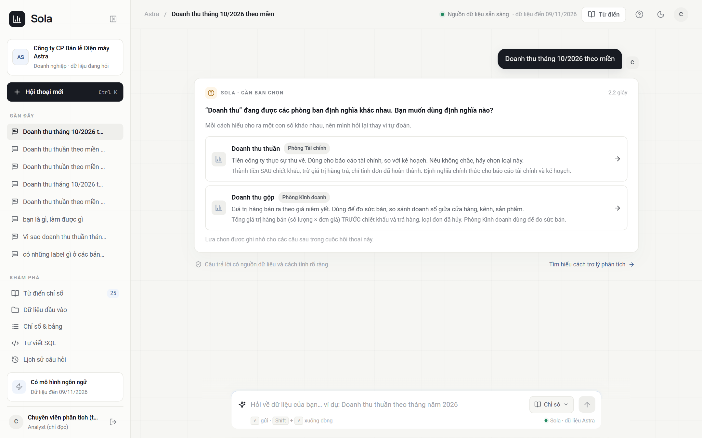

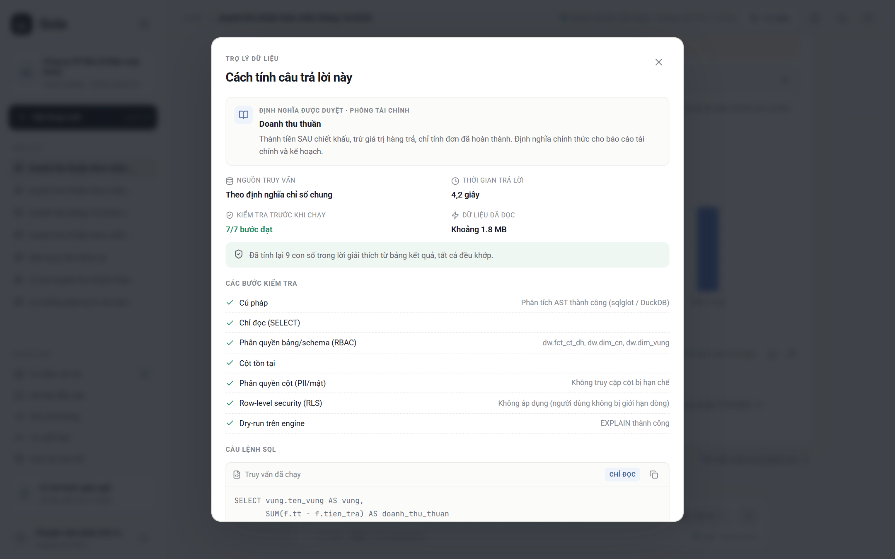

**Chờ duyệt SQL trước khi quét bảng lớn** (bước 3) và **phân quyền theo dòng** với tài khoản `analyst_bac` (bước 4):

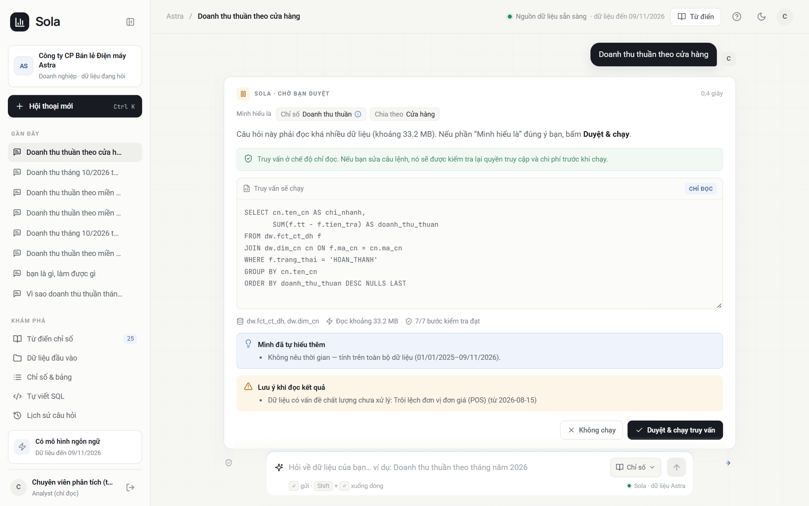

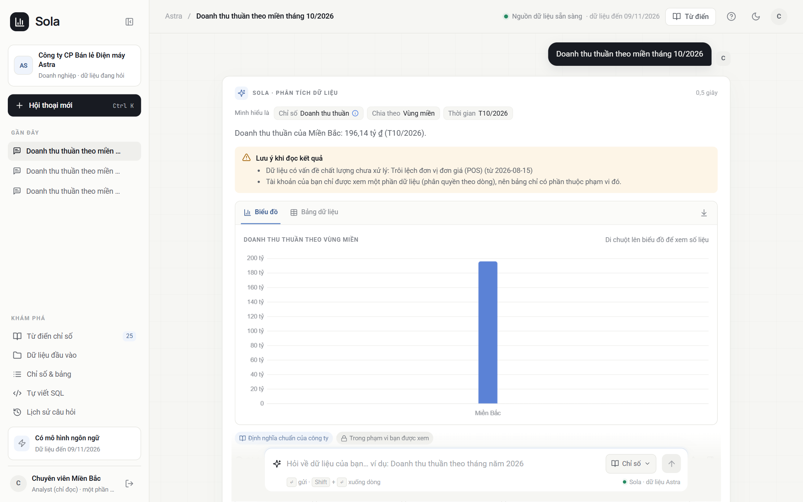

**Tự viết SQL** (bước 5): cột sai `thanh_tien` được sửa thành `tt`, cảnh báo `YEAR(ngay_dh)` làm mất cắt phân vùng:

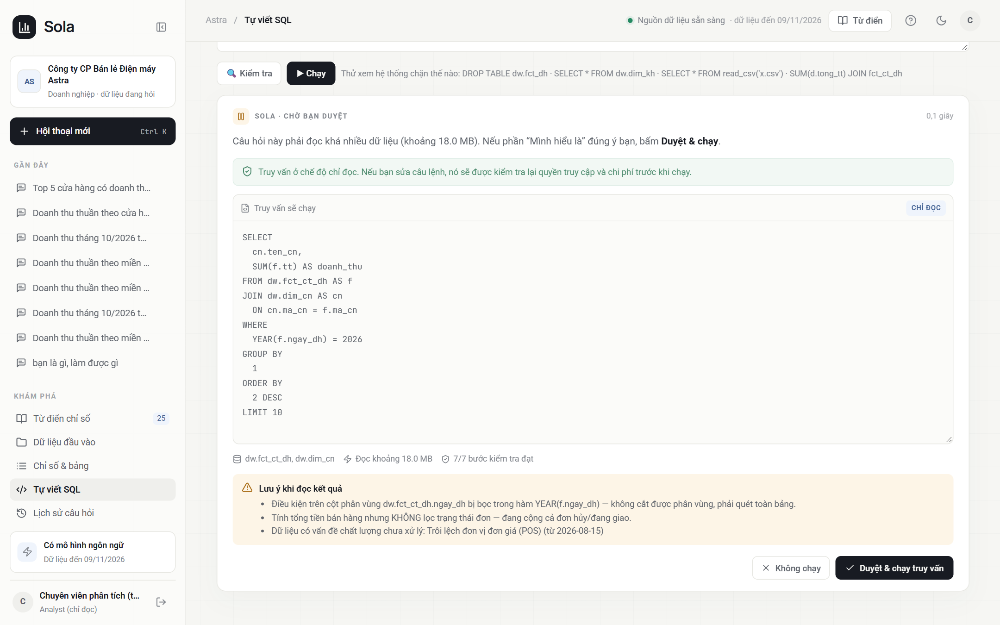

**Phân tích nguyên nhân biến động** (bước 6): kiểm định KS phát hiện đơn giá bị ghi theo nghìn đồng; giả thuyết do mô
hình nêu được code kiểm chứng (bác bỏ / xác nhận):

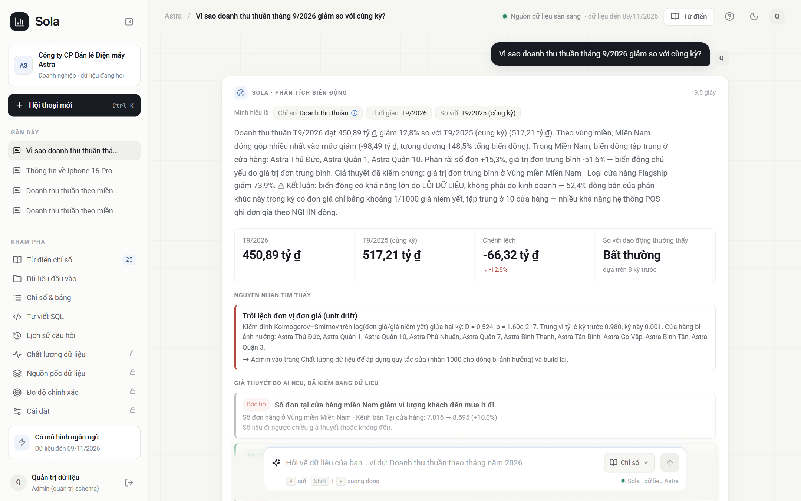

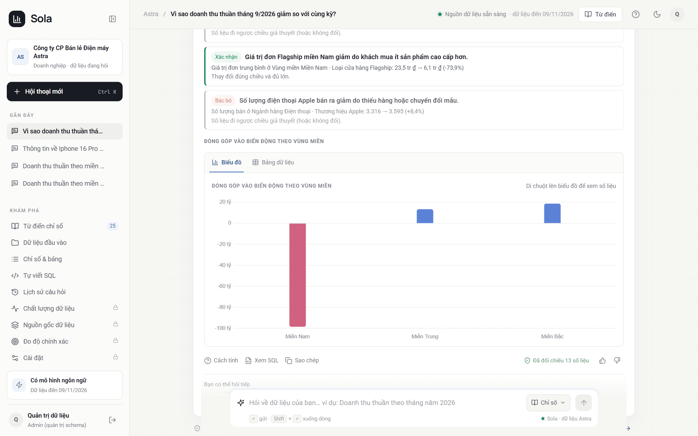

**Các trang trong Khám phá**: chất lượng dữ liệu (bước 8), nguồn gốc dữ liệu (bước 9), lịch sử câu hỏi, đo độ chính xác (bước 10).
Các trang dành riêng cho admin có biểu tượng khóa và tiêu đề nhóm “Quản trị”; lịch sử câu hỏi có cho mọi tài khoản:

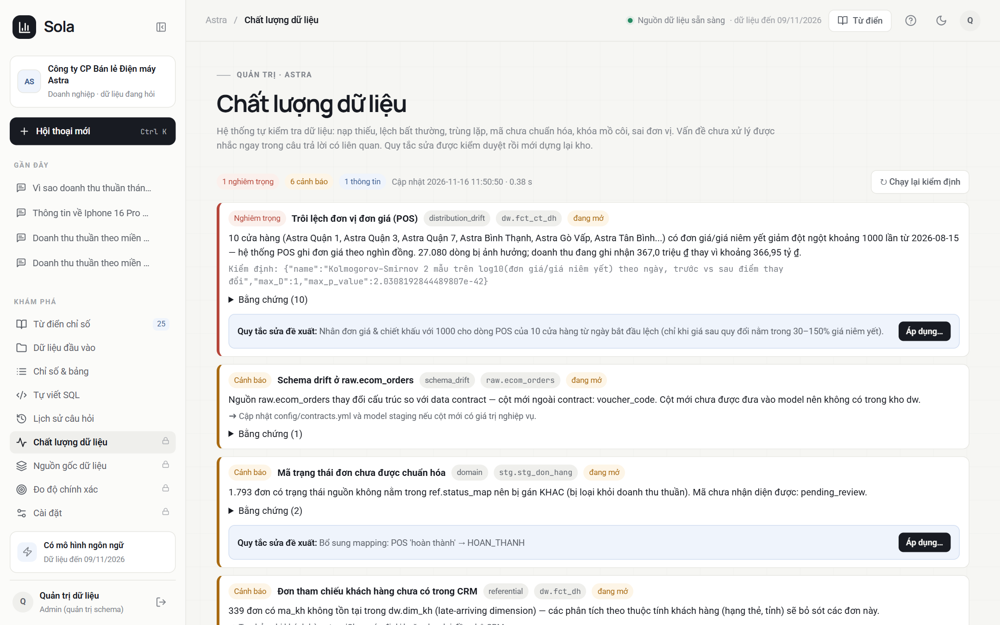

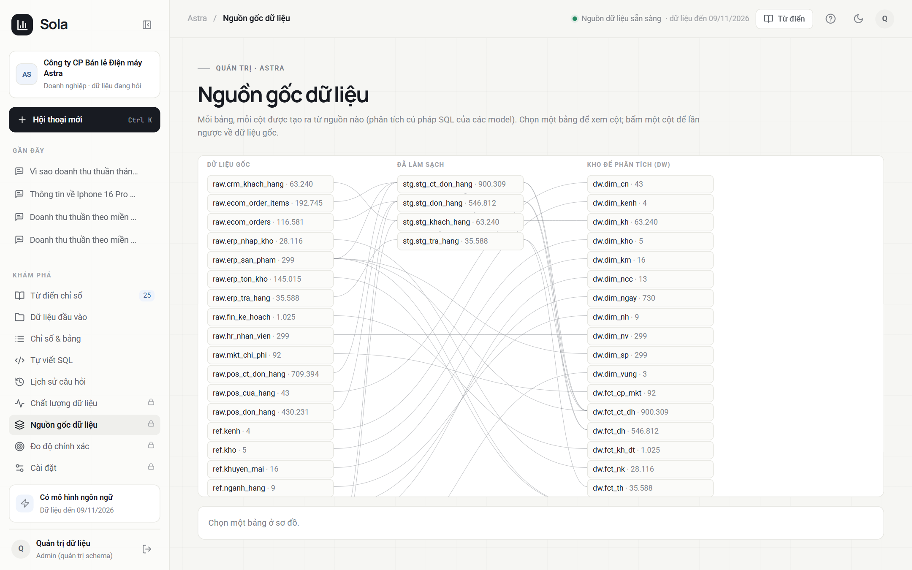

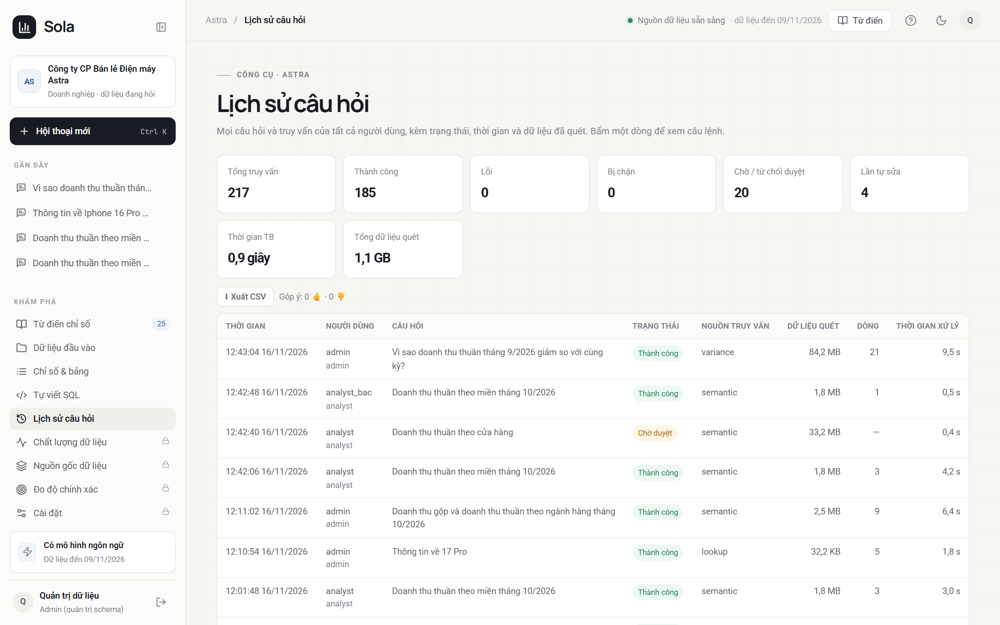

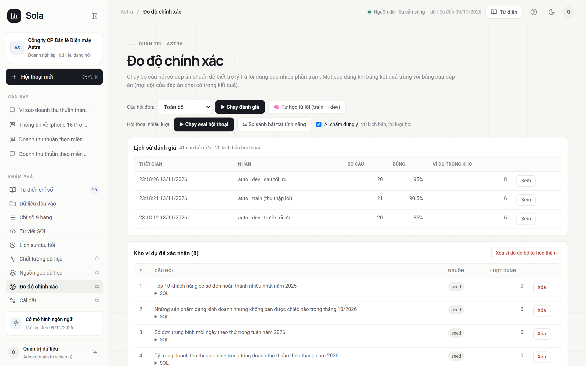

Doanh nghiệp thứ hai chạy cùng giao diện với nội dung của riêng mình (`.\run.ps1 -Workspace giaovan_apex -Port 8001`):

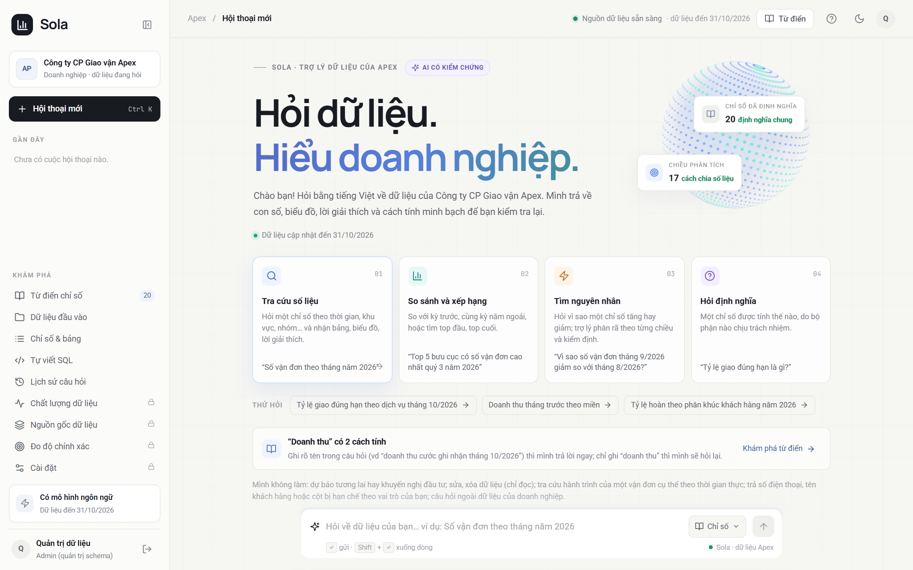

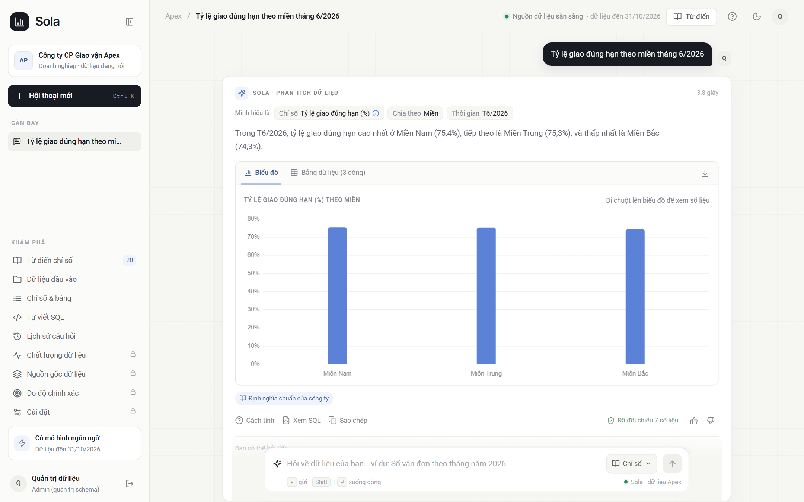

Ảnh khác trong `docs/screenshots/`: `dictionary.png` (từ điển chỉ số), `dark.png` (chế độ tối), `mobile.png`
(màn hình điện thoại). `expert.png` và `variance_apex.png` là ảnh của giao diện cũ, giữ lại để tham khảo.

---

## 4. Kiến trúc

```
Trình duyệt (web/: HTML + JS thuần + Chart.js)
        │  JWT (HS256, tương thích Supabase Auth)
FastAPI (app/main.py) ──► Agent (app/agent.py) — đồ thị trạng thái kiểu LangGraph:
   load_context ─► planner ─┬─► clarify (hỏi lại, lưu lựa chọn vào bộ nhớ hội thoại)
                            ├─► responder (định nghĩa chỉ số / schema / DQ / trợ giúp)
                            ├─► variance_analyst (insights.py: phân rã, drill-down, kiểm định, nguyên nhân gốc)
                            └─► sql_generator ─► optimizer ─► validator ⇄ repairer (rule-based / LLM)
                                                                 │
                                                  cost_guard ── HITL (chờ duyệt) ── executor ─► analyst ─► explainer ─► critic ─► finalize (log, bộ nhớ)
                                                                                              │ chưa đúng
                                                                                              └─► Planner lập lại (1 lần)
   planner = chốt chặn bằng code (chủ đề cấm, sửa/xóa dữ liệu, cột bị hạn chế, dự báo, mã không tồn tại, tra cứu mã)
             ─► đường nhanh: bộ luật (nlu.py) hiểu TRỌN VẸN câu hỏi → không gọi mô hình
             ─► Router (model nhanh): ý định, câu hỏi độc lập, tách câu nhiều ý; câu lạc đề/xã giao trả lời ngay.
                Planner chạy đón trước SONG SONG với Router trên câu gốc; Router không đổi nội dung câu thì dùng luôn
             ─► câu nhiều ý (tối đa 4): mỗi ý chạy song song như một câu độc lập, gộp thành câu trả lời nhiều khối
             ─► đường nhanh trên câu đã viết lại ─► SQL đã xác nhận ─► thuật ngữ mơ hồ / thiếu chỉ số: hỏi lại bằng code
             ─► Planner: thường MỘT lượt gọi — code đưa sẵn bản nháp của bộ luật và mô tả cột của các bảng liên quan
                nhất (schema linking); mô hình nộp thẳng kế hoạch, code biên dịch / chạy thử ngay lúc nộp và trả lỗi
                lại trong cùng hội thoại. Tool (search_schema, describe_table, get_column_values...) chỉ dùng khi cần
             ─► kiểm tra độ bao phủ bằng code: plan không được bỏ qua mã/từ trong câu hỏi rồi trả số liệu chung
             ─► Critic lớp code: plan thiếu bộ lọc/kỳ/cách chia/top N người dùng NÊU RÕ thì vá và báo; chỉ số được hỏi
                đứng đầu câu trả lời
   critic   = LLM chấm (model nhanh, chạy song song với lượt viết lời) kết quả của Planner: “chưa đúng” thì Planner
              lập lại kế hoạch một lần kèm nhận xét, hết thời gian thì câu trả lời mang cảnh báo
        │
DuckDB read-only (enable_external_access=false, lock_configuration, timeout) ◄─ kho của workspace đang chọn
```

Đầu ra của LLM không được tin ngay. Kế hoạch truy vấn được chuẩn hóa và đối chiếu với kho (`app/semantic.py`): giá trị
lọc sai chính tả được đưa về đúng, giá trị không tồn tại bị trả lại kèm danh sách hợp lệ thay vì cho ra kết quả rỗng.
Thuật ngữ mơ hồ do doanh nghiệp khai báo được hỏi lại bằng code trước khi gọi LLM. Phân tích nguyên nhân chỉ chạy cho
câu hỏi “vì sao”, nhận diện bằng code chứ không theo nhãn của mô hình. Vòng lặp gọi tool dừng sớm khi mô hình lặp cùng
một lời gọi lỗi và buộc nộp bài ở lượt cuối.

| Thành phần | File | Ghi chú |
|---|---|---|
| Semantic layer (dbt semantic model) | `config/semantic_layer.yml`, `app/semantic.py` | 25 chỉ số có chủ sở hữu, 24 chiều, 7 model; derived & đa bảng sự kiện, so sánh kỳ, HAVING, semi-additive |
| Data catalog | `config/catalog.yml`, `app/catalog.py` | mô tả cột viết tắt, độ nhạy (PII/mật); Admin sửa trực tiếp |
| Governance | `config/policies.yml`, `app/governance.py` | RBAC theo schema & cột, RLS bằng AST rewrite, chặn DDL/DML/hàm file |
| Chi phí quét | `app/cost.py` | bytes = Σ dòng sau cắt phân vùng × độ rộng cột tham chiếu; ngưỡng cảnh báo / duyệt / chặn theo vai trò |
| Phân tích tĩnh & lineage | `app/sqlcheck.py`, `app/lineage.py` | lint L001–L010 (fan-out, semi-additive, thiếu lọc trạng thái, không sargable…), đối chiếu định nghĩa chỉ số, lineage cột tới raw |
| Diễn giải có kiểm chứng | `app/explain.py` | facts có công thức tái tính; văn bản chỉ chèn số qua placeholder; audit mọi token số |
| Sửa lỗi & tối ưu SQL | `app/repair.py` | sửa cột/bảng/GROUP BY/fan-out/chia 0; viết lại `YEAR()`/`STRFTIME()` thành khoảng ngày |
| Phân tích biến động | `app/insights.py` | z-score (MoM/YoY), phân rã theo “lift”, drill-down, số đơn × giá trị đơn, KS test unit drift, đóng cửa hàng, hết hàng, lịch KM |
| Chất lượng & drift | `app/dq.py` | schema drift (data contract), mapping, trùng, mồ côi, unit drift (change-point + KS), outlier ×10, volume, PSI + chi-square, freshness; quy tắc sửa + rebuild |
| RAG schema & few-shot | `app/retriever.py`, `config/fewshots.yml` | BM25 (thay được bằng Qdrant/pgvector), tái sử dụng SQL đã xác nhận |
| Eval & tự tối ưu | `eval/questions.json`, `app/evals.py` | Execution accuracy chuẩn Spider 2.0; học few-shot từ lỗi train, đo trên dev |
| LLM | `app/llm.py` | hai client cùng giao diện: OpenRouter (API kiểu OpenAI, gọi bằng thư viện chuẩn) và Claude (tool use, structured outputs, prompt caching, `fallbacks: "default"`) |
| Hồ sơ doanh nghiệp & workspace | `config/profile.yml`, `app/profile.py`, `app/config.py` | lời tự giới thiệu dựng bằng code, chọn doanh nghiệp bằng `WORKSPACE` |
| Nhận kho dữ liệu mới | `app/onboard.py` | thống kê catalog và nháp cấu hình cho một kho DuckDB bất kỳ |

---

## 5. Bộ dữ liệu giả

`warehouse/generate.py` sinh kho dữ liệu của chuỗi bán lẻ điện máy hư cấu (43 cửa hàng, 5 kho, ~300 SKU,
01/01/2025 → 09/11/2026, ~547k đơn, ~900k dòng) từ **7 hệ thống nguồn** với dữ liệu bẩn thực tế:

| Nguồn | Bảng raw | “Bẩn” có chủ đích |
|---|---|---|
| POS cửa hàng | `pos_don_hang`, `pos_ct_don_hang`, `pos_cua_hang` | mã trạng thái lẫn lộn (`HT`, `ht`, `Hoàn thành`), số lượng âm, tiền CK NULL, giá gõ thừa số 0 |
| E-commerce | `ecom_orders`, `ecom_order_items` | cột tiếng Anh, ngày dạng chuỗi `DD/MM/YYYY`, `COMPLETED `/`canceled`/`pending_review`, dòng trùng, cột mới `voucher_code` |
| CRM | `crm_khach_hang` | tỉnh viết nhiều kiểu (`tp hcm`, `Sài Gòn`, `HN`…), giới tính `M/Nam/nam/Male`, trùng SĐT |
| ERP | `erp_san_pham`, `erp_ton_kho`, `erp_nhap_kho`, `erp_tra_hang` | tồn kho tuần (semi-additive), phiếu nhập, trả hàng |
| HR | `hr_nhan_vien` | lương (dữ liệu mật) |
| Tài chính | `fin_ke_hoach` | kế hoạch doanh thu tháng × cửa hàng |
| Marketing | `mkt_chi_phi` | chi phí theo tháng × kênh |

Model (`warehouse/models.sql`) làm sạch thành 4 bảng staging và **18 bảng dw** (`fct_ct_dh`, `fct_dh`, `fct_th`,
`fct_tk_tuan`, `fct_nk`, `fct_kh_dt`, `fct_cp_mkt`, 11 dimension) với tên cột viết tắt như kho thật.

**Sự cố cài sẵn để agent phát hiện:** (1) toàn bộ POS TP.HCM ghi đơn giá theo *nghìn đồng* từ 15/08/2026; (2) hết hàng
điện thoại ở kho Đà Nẵng tháng 6/2026; (3) cửa hàng Hải An đóng cửa 30/04/2026; (4) mã trạng thái chưa map; (5) dòng trùng,
số lượng âm, giá ×10; (6) khách trùng SĐT, đơn tham chiếu khách chưa có trong CRM; (7) schema drift `voucher_code`;
(8) ngày cuối nạp thiếu ~60%. Quy mô chỉnh bằng `python warehouse/generate.py --scale 0.5`.

Doanh nghiệp mẫu thứ hai có bộ sinh riêng, `workspaces/giaovan_apex/warehouse/generate.py`: công ty chuyển phát hư cấu
với 31 bưu cục, 4.000 khách hàng, khoảng 247 nghìn vận đơn từ 01/01/2025 đến 31/10/2026, 6 bảng trong schema `mart`.
Ba sự kiện cài sẵn cho câu hỏi “vì sao”: mưa bão Miền Trung 10–25/06/2026 làm tỷ lệ giao đúng hạn giảm; khách hàng
doanh nghiệp lớn nhất Miền Nam ngừng gửi từ 01/09/2026; một bưu cục đóng cửa ngày 01/04/2026. Kho này sạch (không có
tầng raw/staging), nên phần kiểm định nguồn bẩn và quy tắc sửa chỉ minh họa được trên Astra.

---

## 6. Kết quả đo

**Benchmark có nhãn loại câu (`python -m app.bench`).** Mỗi câu được gắn một trong 5 loại: rõ ràng, nối tiếp, mơ hồ
cần hỏi lại, ngoài phạm vi, vượt quyền. Bộ chạy so sánh 5 cách làm, từ đưa schema thẳng cho LLM tới hệ thống đầy đủ,
trên nhiều mô hình. Ngoài execution accuracy, nó còn đo tỷ lệ hỏi thừa, độ phủ và độ chính xác của việc hỏi lại,
tỷ lệ đoán sai câu mơ hồ, và số câu rò rỉ dữ liệu ngoài quyền. Định dạng câu hỏi, mẫu CSV cho người viết câu hỏi và
cách chạy: [eval/benchmark/README.md](../eval/benchmark/README.md). Các bảng dưới đây là bộ eval cũ, chưa chạy lại theo
benchmark mới.

**Kiến trúc hiện tại (Router + đường nhanh + Planner, không còn offline), đo ngày 15/11/2026**, mỗi cấu hình một lượt.
Router dùng `anthropic/claude-haiku-5.5`. Thời gian là thời gian chờ thực tế mỗi câu (chế độ eval không gọi lượt viết lời).

| Doanh nghiệp | Cấu hình | Đúng | Đường đi (nhanh · LLM) | Trung vị | p90 | Chậm nhất |
|---|---|---|---|---|---|---|
| Astra (41 câu) | đường nhanh bật, Planner `gpt-6-luna` | 41/41 | 34 · 7 | 0,2 s | 6,6 s | 12,7 s |
| Apex (26 câu) | đường nhanh bật, Planner `gpt-6-luna` | 25/26 → 26/26 sau sửa* | 23 · 3 | 0,4 s | 2,2 s | 9,4 s |
| Astra (41 câu) | tắt đường nhanh, Planner `gpt-6-luna` | 41/41 | 0 · 41 | 6,5 s | 10,4 s | 14,7 s |
| Astra (41 câu) | tắt đường nhanh, Planner `claude-haiku-5.5` | 41/41 | 0 · 41 | 6,2 s | 8,8 s | 14,0 s |

\* Câu sai: “Doanh thu tháng trước là bao nhiêu?” — Router tự chọn định nghĩa thay người dùng. Đã thêm chốt chặn bằng
code (câu gốc có thuật ngữ mơ hồ thì luôn hỏi lại) và test hồi quy; câu này giờ được hỏi lại đúng. Lượt chạy lại cả bộ Apex (có Critic): 26/26.

**Eval hội thoại (20 kịch bản, 28 lượt) có mô hình chấm, đo ngày 15/11/2026** (`python -m app.conv_eval`; Planner
`gpt-6-luna`, mô hình chấm `claude-haiku-5.5`). Lượt chạy đầu: 14/20 kịch bản đạt. Trong 6 kịch bản trượt có 3 lỗi
thật của bot, đã sửa và có test hồi quy:
- câu nhiều ý có ý 2 nói “cùng kỳ” bị hiểu thành từ đầu năm đến nay;
- “chia theo kênh bán” sau câu “vì sao” lại chạy phân tích nguyên nhân;
- tài khoản chỉ xem được Miền Bắc nhận câu “Dẫn đầu là Miền Bắc”.

3 kịch bản còn lại trượt do lỗi của chính bộ eval (cắt câu trả lời trước khi đưa cho mô hình chấm, so khớp chữ bỏ dấu
nên “tỷ ₫” khớp nhầm “Công ty”). Sau khi sửa: 18/20.

So sánh bật/tắt từng tính năng (mỗi cấu hình chạy một lượt; một kịch bản = 5 điểm, nên chênh 5 điểm nằm trong dao
động giữa các lượt):

| Cấu hình | Kịch bản đạt | Lượt đạt | Trung vị mỗi lượt | p90 | Chậm nhất |
|---|---|---|---|---|---|
| Đầy đủ | 90% | 92,9% | 6,0 s | 9,7 s | 15,6 s |
| Tắt Critic | 90% | 92,9% | 4,4 s | 10,2 s | 12,9 s |
| Tắt đa nhiệm | **70%** | 75,0% | 3,7 s | 8,7 s | 11,2 s |
| Tắt lập kế hoạch đón trước | 90% | 92,9% | 6,1 s | 9,5 s | 10,5 s |
| Tắt giả thuyết biến động | 95% | 96,4% | 3,7 s | 9,1 s | 12,8 s |
| Tắt đường nhanh | 85% | 89,3% | 7,2 s | 9,7 s | 14,7 s |

Đọc kết quả: đa nhiệm là tính năng có tác dụng rõ nhất (tắt đi thì 4 kịch bản nhiều ý chỉ được trả lời ý đầu). Critic,
lập kế hoạch đón trước và giả thuyết biến động không đổi độ đúng ý đo được trên bộ này; trung vị thời gian dao động
2–3 giây giữa các lượt nên cũng chưa kết luận được về tốc độ. Lỗi lặp lại ở nhiều lượt: câu 4 ý (c11) đôi khi mất ý
cuối, và lời diễn giải của mô hình có lần nói “chưa có số đơn theo kênh” dù bảng có cột đó. Mô hình chấm cũng có lần
chấm sai (chê “giá trị đơn trung bình chưa lọc đơn hoàn thành” dù định nghĩa chỉ số đã lọc sẵn).

**Giả thuyết nguyên nhân cho câu “vì sao”** (bước 6 của phân tích biến động): mô hình nêu tối đa 3 giả thuyết, code
chạy truy vấn kiểm chứng. Ví dụ “Vì sao doanh thu thuần tháng 9/2026 giảm so với cùng kỳ?”: bác bỏ “số đơn tại cửa
hàng Miền Nam giảm” (thực ra tăng 10%), xác nhận “giá trị mỗi đơn ở cửa hàng Flagship giảm” (−37%), khớp với lỗi
đơn vị đơn giá mà kiểm định KS tìm ra. Lượt gọi mô hình mất khoảng 5 giây, nên câu “vì sao” đi đường nhanh mất 7–8,5
giây thay vì 0,5–2 giây; câu đã tốn nhiều thời gian ở Planner thì bỏ qua bước này.

**Planner một lượt + chạy đón trước song song Router + trả lời song song câu nhiều ý, đo ngày 15/11/2026** (cấu hình
hiện tại; Planner `gpt-6-luna`, Critic bật):

| Doanh nghiệp | Cấu hình | Đúng | Trung vị | p90 | Chậm nhất | Câu được LLM chấm |
|---|---|---|---|---|---|---|
| Astra (41 câu) | đường nhanh bật | 41/41 | 0,2 s | 5,2 s | 7,5 s | 4/6 câu đi qua Planner |
| Apex (26 câu) | đường nhanh bật | 26/26 | 0,3 s | 1,9 s | 6,5 s | 0/1 |
| Astra (41 câu) | tắt đường nhanh | 41/41 | 5,4 s | 7,0 s | 14,5 s | 33/37 |

So với lượt đo trước khi có ba thay đổi này (Astra tắt đường nhanh: trung vị 6,5 s, p90 10,4 s): Planner thường chỉ còn
một lượt gọi (2,3–4,4 s), và Router (~1,5 s) chạy song song với Planner thay vì nối tiếp.

11 kịch bản hội thoại chạy tay (câu 2–4 ý, câu nối tiếp 3 lượt, định nghĩa + số liệu, xếp hạng + “vì sao”, lạc đề
sau câu số liệu): 10/11 đúng ý; kịch bản còn lại đúng hành vi nhưng một ý phải chờ duyệt SQL vì quét bảng lớn. Trung vị
4,7 s mỗi lượt; chậm nhất 14,3 s (câu 2 ý mà một ý mô hình phải tự viết SQL). Planner `claude-haiku-5.5` đo cùng
lúc không nhanh hơn `gpt-6-luna`, và qua OpenRouter không được đọc prompt từ bộ nhớ đệm (luna đọc 5,5/5,6 nghìn token
từ bộ nhớ đệm) nên giữ `gpt-6-luna`.

**Thêm Critic (tác tử kiểm tra), đo ngày 15/11/2026 (trước khi có Planner một lượt):**

| Doanh nghiệp | Cấu hình | Đúng | Trung vị | p90 | Chậm nhất | Critic |
|---|---|---|---|---|---|---|
| Astra (41 câu) | đường nhanh bật | 41/41 | 0,3 s | 8,4 s | 19,7 s | chấm 6 câu, đều “đúng” |
| Apex (26 câu) | đường nhanh bật | 26/26 | 0,4 s | 1,9 s | 9,7 s | 1 câu không kịp chấm |
| Astra (41 câu) | tắt đường nhanh | 41/41 | 8,1 s | 10,8 s | 18,1 s | 37 câu không kịp chấm |

- Lượt đo đầu tiên của LLM chấm cho ra 2 lần “chưa đúng” với 2 câu thật ra đúng: chỉ số “số đơn hàng” đã lọc sẵn đơn
  hoàn thành; chiều “miền phát” của doanh nghiệp chuyển phát nghĩa là nơi giao tới. Đã sửa bằng cách đưa định nghĩa chỉ
  số và từ đồng nghĩa của chiều vào prompt chấm.
- Chỉ chấm khi còn kịp lập lại kế hoạch (có kết quả trước giây thứ 6). Với Planner `gpt-6-luna` (khoảng 5 giây mỗi lượt
  gọi), phần lớn câu đi qua Planner có kết quả sau mốc này nên không được chấm. Lớp kiểm tra bằng code của Critic chạy
  với mọi câu, không tốn thời gian.
- Câu “trung bình mỗi đơn hàng ở Hà Nội tháng trước” giờ mở đầu bằng giá trị đơn trung bình. Lỗi nằm ở phần diễn giải tự
  động (liệt kê cột theo thứ tự, cột phụ của tỷ số đứng trước), không phải ở mô hình.
- Thời gian của Planner dao động giữa các lượt đo (trung vị 6,5 s và 8,1 s cho cùng cấu hình), chưa đủ mẫu để kết luận
  Critic làm chậm hay không.

Lượt “tắt đường nhanh” đo riêng chất lượng các tác tử LLM: mọi câu đều đi qua Router và Planner mà vẫn đúng 41/41.

Kết quả của kiến trúc cũ (có chế độ offline), đo 12/11/2026:

| Doanh nghiệp | Chế độ | Đúng | Theo độ khó (easy · medium · hard · extra) | Giây/câu | Diễn giải qua audit số liệu |
|---|---|---|---|---|---|
| Astra (41 câu) | bộ luật offline | 36/41 | 100 · 100 · 100 · 28,6 % | 0,3 | 100 % |
| Astra (41 câu) | OpenRouter `openai/gpt-4o-mini` | 38/41 | 100 · 100 · 100 · 57,1 % | 5,8 | 97,3 % |
| Astra (41 câu) | OpenRouter `openai/gpt-6-luna` | 41/41 | 100 · 100 · 100 · 100 % | 6,8 | 100 % |
| Apex (26 câu) | bộ luật offline | 22/26 | 100 · 100 · 88,9 · 0 % | 0,04 | 100 % |
| Apex (26 câu) | OpenRouter `openai/gpt-4o-mini` | 25/26 | 100 · 100 · 100 · 66,7 % | 11,8 | 100 % |
| Apex (26 câu) | OpenRouter `openai/gpt-6-luna` | 26/26 | 100 · 100 · 100 · 100 % | 6,2 | 100 % |

Cách đọc các con số này:

- Các câu “extra” nằm ngoài semantic layer (top khách hàng, danh sách có điều kiện, trung bình theo thứ trong tuần…).
  Bộ luật không diễn đạt được nên các câu này luôn đi qua Planner; LLM tự viết SQL qua `dry_run_sql`.
- Bộ câu hỏi do người xây hệ thống viết và đã được dùng để sửa lỗi, nên kết quả lạc quan hơn so với câu hỏi của người
  dùng thật. Cùng một cấu hình chạy lại có thể lệch 1–2 câu.
- Execution accuracy không đo được lỗi “trả lời lạc đề / sai trọng tâm”. Bộ câu hỏi hội thoại có chấm bằng LLM-judge là
  bước tiếp theo trong lộ trình (kèm tác tử Critic).
- Kết quả eval ghi đường đi (`path`) và ý định Router (`route`) của từng câu.
- **Chế độ Claude chưa được đo** vì chưa có khóa Anthropic; vòng lặp gọi tool của Claude mới được kiểm bằng client giả.
- Chức năng tự tối ưu few-shot (học từ lỗi trên tập train, đo trên tập dev) có sẵn ở trang Đánh giá nhưng chưa được đo
  lại sau các thay đổi này.

---

## 7. API chính

`POST /api/login` · `POST /api/chat` · `POST /api/approve` · `POST /api/sql/validate` · `POST /api/sql/run` ·
`POST /api/feedback` · `GET /api/schema` · `PUT /api/admin/catalog` · `GET /api/logs` (+ `.csv`) · `GET|POST /api/dq…` ·
`GET /api/lineage` · `POST /api/eval/run` · `POST /api/eval/optimize` · `GET|PUT /api/admin/settings`. Tài liệu tự sinh:
<http://127.0.0.1:8000/docs>.

## 8. Triển khai

`Dockerfile` sinh dữ liệu lúc build (`DATA_SCALE=0.5`); `render.yaml` cho Render (Railway dùng chung Dockerfile).
Đặt `APP_SECRET`, tùy chọn `OPENROUTER_API_KEY` hoặc `ANTHROPIC_API_KEY`, `SUPABASE_JWT_SECRET` (đăng nhập bằng Supabase
Auth, vai trò lấy từ `app_metadata.role`, RLS từ `app_metadata.rls`). Các bước chi tiết và danh sách việc phải làm trước
khi đưa lên mạng: [04-deploy-len-web.md](04-deploy-len-web.md).

Tài liệu cho người mới (kỹ thuật, cách dùng, cách chạy, cách deploy) nằm trong [Mục lục tài liệu](README.md).

## 9. Khác biệt so với techstack gợi ý & hướng mở rộng

- **Frontend Sola** là HTML/CSS/JS thuần + Chart.js (không cần build), có thanh bên thu gọn, sáng/tối và bố cục cho điện thoại, thay cho Next.js + Recharts; API đã tách
  sẵn để thay frontend.
- **LangGraph** → đồ thị trạng thái tự viết cùng mô hình node/edge (không thêm phụ thuộc, trace từng node trên UI).
- **Vector DB** → BM25 local; interface `search_schema/search_fewshots` thay được bằng Qdrant/pgvector.
- **Warehouse** → DuckDB (mô phỏng phân vùng theo ngày & bytes-scanned kiểu BigQuery); SQL dialect qua sqlglot nên
  chuyển sang BigQuery/Snowflake/Trino chủ yếu là đổi `DIALECT` và connector.
- Đường nhanh (nlu.py) chỉ bao phủ các câu hỏi biểu diễn được bằng semantic layer; câu tự do cần LLM.
